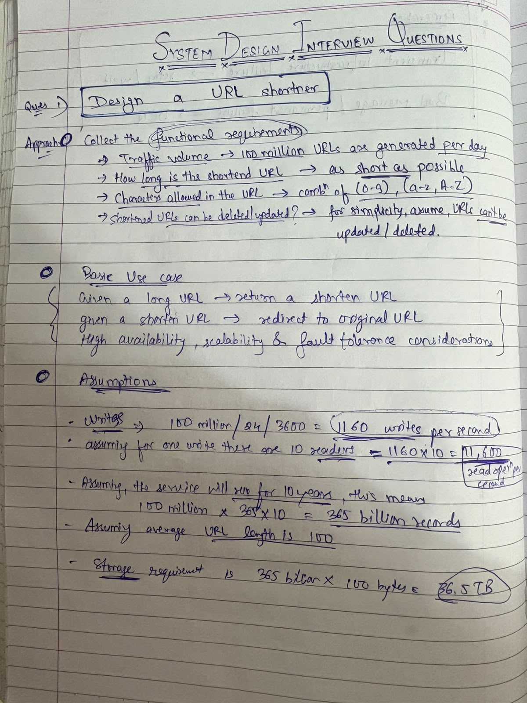
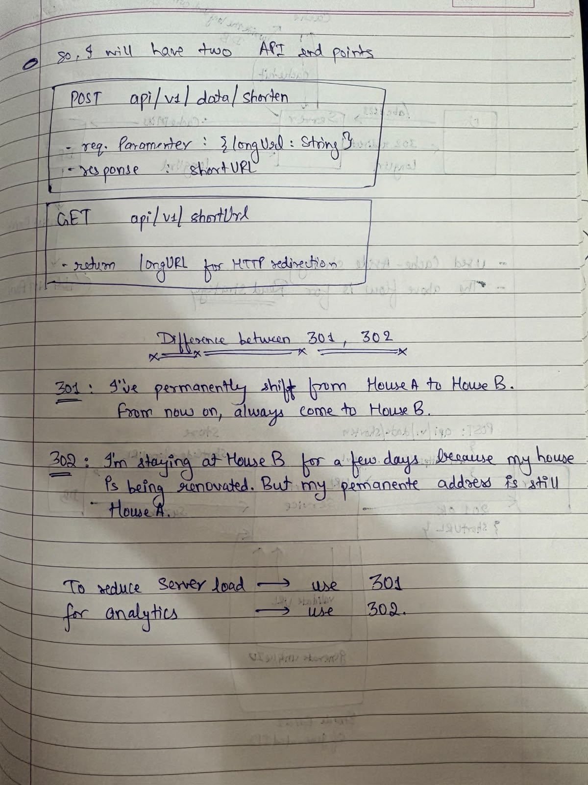

# 001. Design a URL Shortener

## Problem Statement

Design a scalable URL shortening service similar to TinyURL or Bitly.

The system should allow users to convert long URLs into shorter, unique URLs that are easier to share and manage.

When a user accesses a shortened URL, the system should redirect them to the corresponding original URL.

The system should be designed to handle a large number of URL shortening requests and redirects while maintaining low latency, high availability, and reliability.

### Functional Requirements

1. **Shorten URL:** Users should be able to submit a long URL and receive a unique shortened URL.
2. **URL Redirection:** Accessing a shortened URL should redirect users to the original URL.
3. **Custom Aliases (Optional):** Users may specify a custom alias for their shortened URLs.
4. **URL Expiration (Optional):** Users may configure an expiration time for shortened URLs.

### Non-Functional Requirements

1. **Scalability:** The system should support a large number of URLs and concurrent requests.
2. **Low Latency:** URL redirection should be fast.
3. **High Availability:** The service should remain accessible with minimal downtime.
4. **Uniqueness:** Each generated short URL should correctly identify its intended destination.
5. **Reliability:** URL mappings should remain consistent and accessible.

### Design Considerations

While designing the system, consider:

- How short URLs are generated.
- How URL mappings are stored and retrieved.
- How to handle collisions between generated short URLs.
- How to optimize read-heavy traffic.
- How the system can scale as traffic increases.
- How to handle failures and maintain availability.

> **Note:** Traffic estimates, storage requirements, database choices, caching strategies, and architectural decisions should be determined during the design process and documented separately under assumptions and solutions.

### Reference

[ByteByteGo: Design a URL Shortener](https://bytebytego.com/courses/system-design-interview/design-a-url-shortener)

---

## 1. Requirements and Assumptions

My initial requirements, traffic assumptions, and capacity estimates are documented below.

---

## 2. High-Level Design

The high-level design was created in Excalidraw and covers URL creation and redirection flows.

<!-- Add architecture.png to assets/ and embed it here. -->

[Open the editable Excalidraw diagram](assets/url-shortener-flow.excalidraw)

---

## 3. My Solution

My initial solution notes cover the API contract and redirect behavior.

---

## 4. Design Decisions and Trade-offs

The current notes compare 301 and 302 redirects. Further trade-offs will be documented as the solution evolves.
