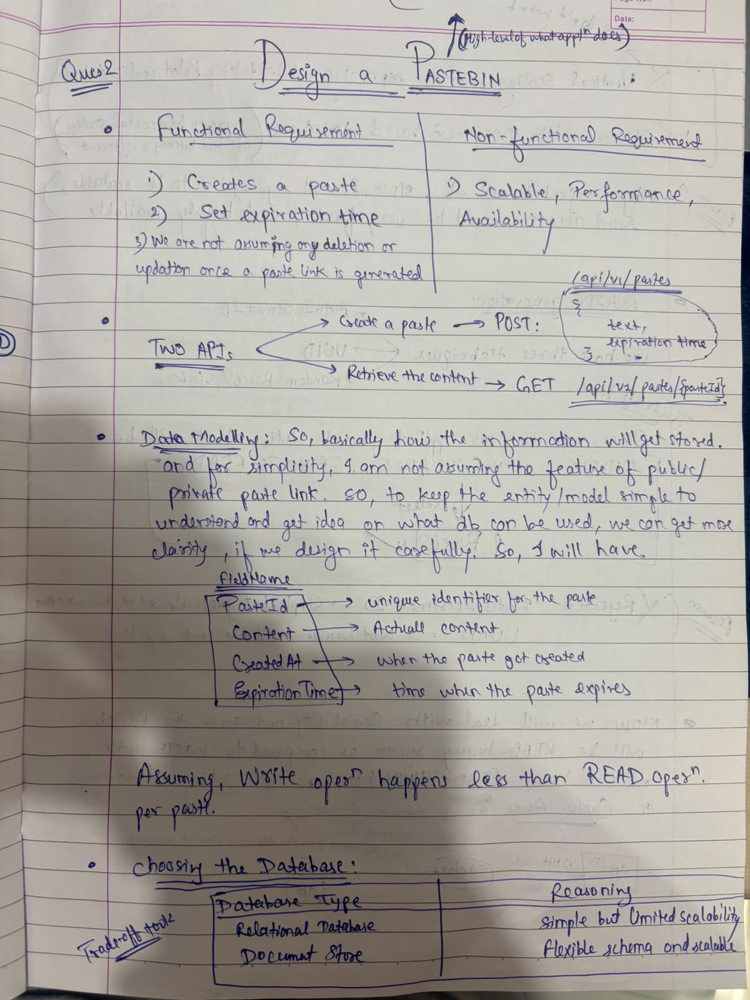
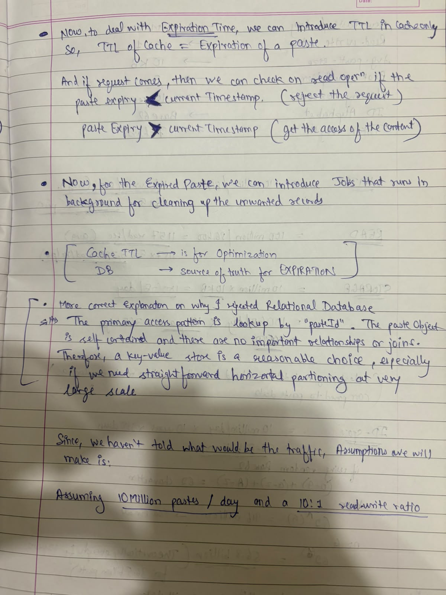
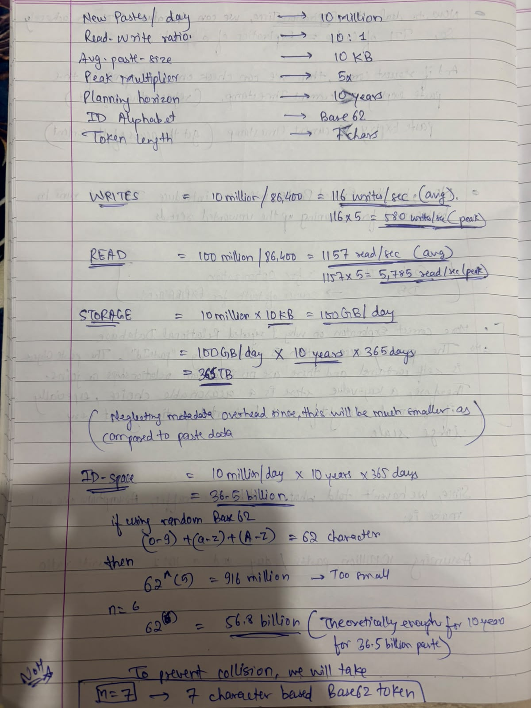
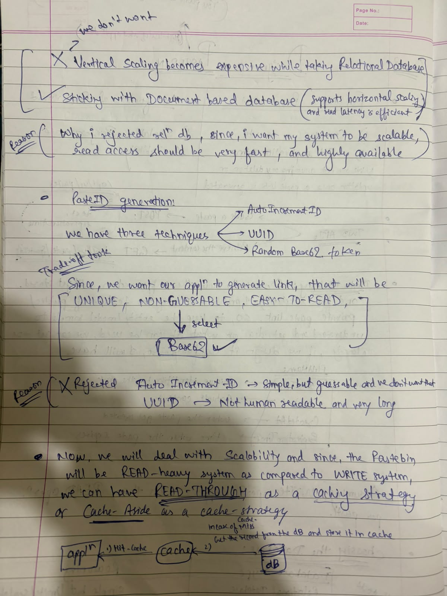

# 002. Design Pastebin

## Problem Statement

Design a scalable Pastebin-like service where users can store text and receive a unique URL for retrieving it later.

The service should support optional expiration while keeping paste creation reliable and paste retrieval fast for a read-heavy workload.

### Reference

[System Design Handbook: Design Pastebin](https://www.systemdesignhandbook.com/guides/design-pastebin/)

---

## 1. Requirements and Assumptions

### Functional Requirements

1. Create a paste containing text.
2. Retrieve a paste using its unique ID.
3. Allow an expiration time to be set when the paste is created.

Updates and explicit deletion are outside the current scope. Public and private visibility are also excluded to keep the initial design focused.

### Non-Functional Requirements

- Scale horizontally as traffic and stored content grow.
- Keep paste retrieval latency low.
- Remain highly available.
- Preserve paste content until it expires.

### Traffic and Capacity Assumptions

| Assumption | Value |
|---|---:|
| New pastes | 10 million per day |
| Read-to-write ratio | 10:1 |
| Average paste size | 10 KB |
| Peak traffic multiplier | 5× |
| Planning horizon | 10 years |
| Paste ID alphabet | Base62 |
| Paste ID length | 7 characters |

These assumptions produce the following estimates:

| Metric | Average | Peak |
|---|---:|---:|
| Writes | ~116 requests/second | ~580 requests/second |
| Reads | ~1,157 requests/second | ~5,785 requests/second |

The service receives about 100 GB of new paste content per day. Retaining every paste for the full planning horizon would require roughly 365 TB over ten years, excluding metadata and replication overhead. Actual retained storage should be lower when expired records are removed. At this rate the service creates approximately 36.5 billion paste IDs.

---

## 2. High-Level Design

The architecture separates paste creation from the read-heavy retrieval path:

- The write path validates the request, generates a random Base62 ID, stores the paste, and returns the ID with `201 Created`.
- The read path checks the cache first and falls back to the database on a cache miss.
- Active records returned by the database are added to the cache with a TTL based on their remaining lifetime.
- Missing paste IDs return `404 Not Found`; expired pastes return `410 Gone`.
- A scheduled background job deletes expired records in batches.

[Open the editable Excalidraw diagram](assets/pastebin-flow.excalidraw)

---

## 3. My Solution

### API Design

| Method | Endpoint | Purpose |
|---|---|---|
| `POST` | `/api/v1/pastes` | Create a paste from `content` and `expiresAt` and return its `pasteId` |
| `GET` | `/api/v1/pastes/{pasteId}` | Retrieve active paste content by ID |

### Data Model

| Field | Purpose |
|---|---|
| `pasteId` | Unique identifier used in the paste URL |
| `content` | Text stored in the paste |
| `createdAt` | Paste creation timestamp |
| `expiresAt` | Timestamp after which the paste must not be served |

### Storage

A horizontally scalable document or key-value store fits the primary access pattern: direct lookup by `pasteId`. Each paste is self-contained, and the current design does not require relationships or joins.

### Paste ID Generation

The service generates a random seven-character Base62 token. Base62 keeps IDs compact and URL-friendly, while seven characters provide about 3.5 trillion possible values.

Random generation can still produce collisions. Before storing a paste, the service must verify that the generated ID is unused and retry when a collision occurs.

### Caching

The retrieval path uses a cache-aside strategy:

1. Look up the `pasteId` in the cache.
2. Return the cached content on a hit.
3. On a miss, read the record from the database and verify that it has not expired.
4. Cache an active paste with `TTL = expiresAt - current time` before returning it.

The database remains the source of truth for expiration. Cache TTL improves performance but does not replace the read-time expiration check.

### Expiration and Cleanup

An expired paste is rejected during retrieval even if its record has not yet been physically deleted. Scheduled background jobs reclaim storage by deleting expired records in batches without blocking user requests.

---

## 4. Design Decisions and Trade-offs

- **Document/key-value storage over a relational database:** supports direct ID lookups and horizontal partitioning without introducing unused relational features.
- **Random Base62 IDs over auto-increment IDs:** produces compact, less guessable URLs but requires collision detection and retry logic.
- **Seven-character IDs over six-character IDs:** increases the available ID space and reduces collision frequency at the cost of one extra character.
- **Cache-aside reads:** reduces database load and read latency, while cache misses still have a reliable database fallback.
- **Lazy expiration with background cleanup:** keeps requests correct immediately after expiration without requiring synchronous deletion from every storage layer.

---

## 5. Future Improvements

Possible extensions include visibility controls, authentication, abuse prevention, rate limiting, and support for larger paste content. These are intentionally outside the current design.
