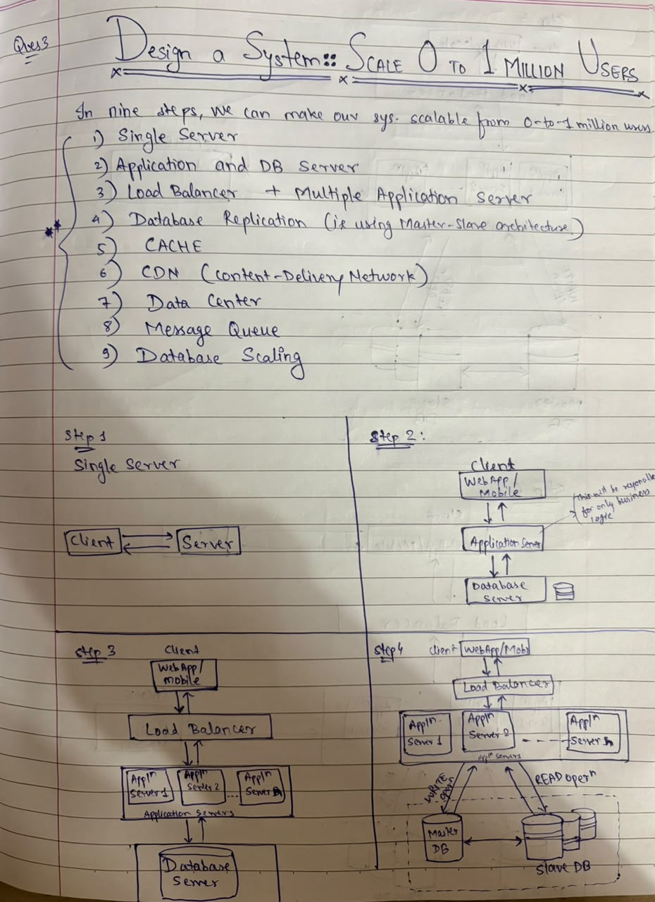
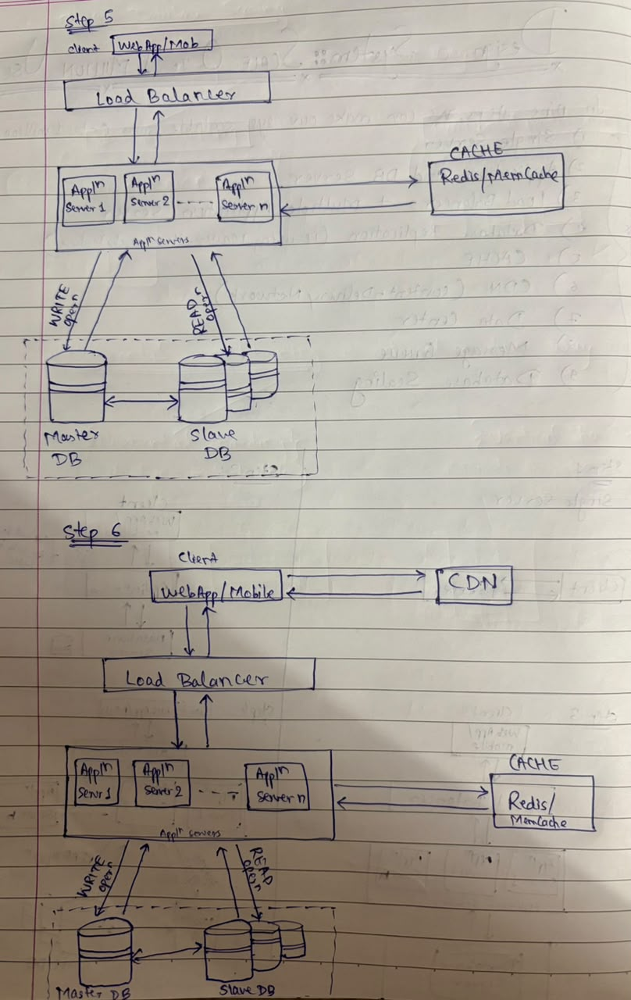
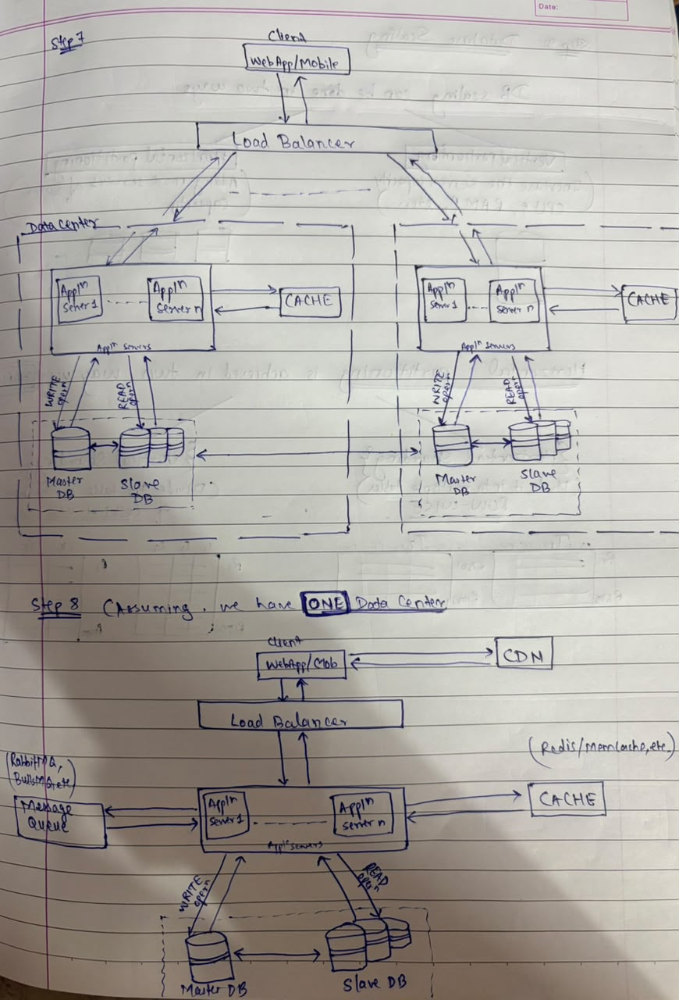
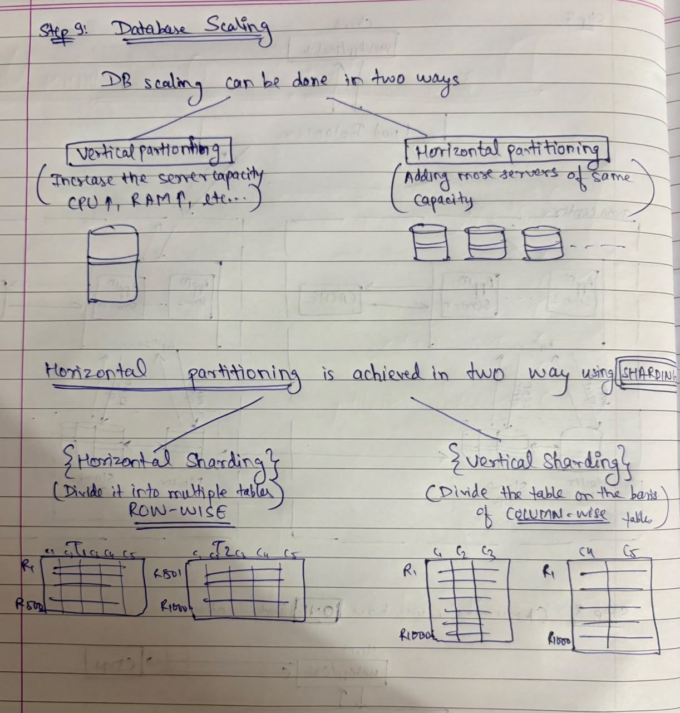

# 003. Scale from Zero to One Million Users

## Problem Statement

Explain how a small application can evolve from a single server into a scalable, highly available system capable of supporting millions of users.

The goal is not to add every component on day one. Each step should solve a real bottleneck introduced by growth.

### Reference

[YouTube: Scale from Zero to Million Users](https://youtu.be/rExh5cPMZcI?si=JrHALfWG_zgNEcPd)

---

## 1. Scaling Journey

| Step | Architecture change | Why it is introduced |
|---:|---|---|
| 1 | Single server | The simplest and cheapest starting point for low traffic. |
| 2 | Separate application and database servers | Application and database resources can be managed independently. |
| 3 | Load balancer and multiple application servers | Distributes traffic, removes one application server as a single point of failure, and enables horizontal application scaling. |
| 4 | Primary database with read replicas | Sends writes to the primary and distributes read traffic across replicas while improving availability. |
| 5 | Cache | Serves frequently requested data from memory and reduces database load. |
| 6 | CDN | Delivers static assets from locations closer to users, reducing latency and origin traffic. |
| 7 | Multiple data centers | Improves geographic latency and provides disaster-recovery options. |
| 8 | Message queue | Moves slow or retryable work out of the request path and absorbs traffic spikes. |
| 9 | Database scaling | Increases database capacity through scale-up, replication, partitioning, or sharding. |

### A Real-Life Analogy: Growing a Restaurant

Think of the system as a restaurant that becomes popular:

- **Single server:** One person takes orders, cooks, and collects payment.
- **Separate application and database:** The waiter takes orders while the kitchen stores recipes and prepares food.
- **Load balancer:** A host sends each customer to an available waiter.
- **Application servers:** Multiple waiters handle customers in parallel.
- **Database replicas:** Several menu boards answer common questions, while one controlled system records changes.
- **Cache:** Frequently ordered items are kept ready near the counter.
- **CDN:** Smaller neighborhood pickup counters keep popular items close to customers.
- **Multiple data centers:** The restaurant opens branches in different cities.
- **Message queue:** Order tickets wait on a kitchen rail, so cooks process them without blocking the cashier.
- **Database sharding:** Different warehouses store different groups of inventory instead of forcing one warehouse to hold everything.

The memory rule is: **separate, duplicate, distribute, cache, move closer, process asynchronously, then partition data.**

---

## 2. Message Queue

A message queue lets the application hand work to another service without waiting for that work to finish. For example, after a user places an order, the application can publish events for email, billing, analytics, and inventory processing. Workers handle those tasks independently.

### Why Use It?

- Keeps slow work outside the user request path.
- Buffers sudden traffic spikes.
- Decouples producers from consumers.
- Allows failed work to be retried.
- Lets worker capacity scale independently.

The trade-offs are additional operational complexity, delayed processing, duplicate-delivery handling, ordering concerns, retries, and dead-letter handling.

### Core Messaging Terms

| Term | Meaning | Restaurant analogy |
|---|---|---|
| **Producer** | Application that publishes a message. | The waiter writes an order ticket. |
| **Exchange** | RabbitMQ component that receives messages and decides which queues receive them. | The kitchen coordinator sorts tickets. |
| **Queue** | Buffer that stores messages until consumers process them. | A ticket rail holding pending orders. |
| **Consumer** | Worker that reads and processes messages from a queue. | A cook taking the next ticket. |
| **Routing key** | Label attached to a message and used by an exchange for routing. | A label such as `drink.cold` or `meal.vegetarian`. |
| **Binding** | Rule connecting an exchange to a queue, optionally using a binding key or pattern. | “Send every dessert ticket to the pastry station.” |
| **Fanout** | Broadcasts a copy of every message to every queue bound to the fanout exchange; routing keys are ignored. | The coordinator copies one announcement to every kitchen station. |
| **Topic** | A topic exchange routes messages by matching dot-separated routing keys against binding patterns. | Stations subscribe to categories such as `order.*` or `order.#`. |

### Fanout vs Topic

**Fanout exchange:** use it when every interested subsystem should receive the same event. An `order.created` message could be copied to separate email, analytics, and audit queues.

**Topic exchange:** use it when consumers need selected categories. A message with routing key `order.payment.failed` can match:

- `order.*.*` — exactly three words beginning with `order`.
- `order.#` — `order` followed by zero or more words.
- `*.payment.*` — any three-word event whose middle word is `payment`.

Fanout requires separate queues for separate subscribers. Multiple workers consuming from the **same** queue normally share the work; they do not each receive a copy.

> **Terminology note:** Exchange, binding, routing key, fanout exchange, and topic exchange are RabbitMQ/AMQP terms. Kafka uses a different model where a topic is a partitioned event log, while BullMQ is built around Redis-backed queues and does not use RabbitMQ exchanges and bindings.

---

## 3. Database Scaling

### Vertical vs Horizontal Scaling

| Approach | Meaning | Use when | Advantages | Limitations |
|---|---|---|---|---|
| **Vertical scaling (scale up)** | Give one database server more CPU, RAM, storage, or faster disks. | The system is still small or a larger machine can solve the immediate bottleneck. | Simple architecture; no data distribution or cross-node routing. | Hardware has a ceiling; large machines are expensive; the server remains a major failure boundary. |
| **Horizontal scaling (scale out)** | Add database servers and divide data or work among them. | One server cannot handle the data size, read/write throughput, or growth rate. | Capacity can grow by adding nodes; load and storage are distributed. | Routing, rebalancing, cross-shard queries, transactions, and operations become more complex. |

Vertical scaling is like buying a larger delivery truck. Horizontal scaling is like operating several trucks and deciding which package goes into each one.

### Replication Is Not Sharding

- **Replication** keeps copies of the same data on multiple servers for availability and read scaling.
- **Sharding** stores different subsets of data on different servers for storage and read/write scaling.

A system often uses both: each shard can have its own replicas.

### How Horizontal Scaling Works with Sharding

1. Choose a **shard key**, such as `userId`.
2. Apply a routing rule to determine which shard owns each record.
3. Send queries containing the shard key directly to the correct shard.
4. Rebalance data when shards are added, removed, or become uneven.

Queries without the shard key may need a scatter-gather request across every shard, which is slower and more expensive.

### Sharding Strategies

| Strategy | How it works | Use when | Advantages | Disadvantages / avoid when |
|---|---|---|---|---|
| **Range-based sharding** | Assigns continuous key ranges to shards, such as users `A–F`, `G–M`, and `N–Z`. | Range queries and ordered scans are common, and the key distribution is predictable. | Efficient range queries; related data stays together. | Uneven ranges and monotonically increasing keys can create hot shards; rebalancing ranges can be expensive. |
| **Hash-based sharding** | Hashes the shard key and maps the result to a shard. | Even traffic distribution and equality lookups are more important than range scans. | Usually distributes data and writes evenly; avoids sequential-key hotspots. | Range queries may contact many shards; changing the shard count can move large amounts of data. Consistent hashing reduces, but does not eliminate, that movement. |
| **Directory-based sharding** | A lookup service stores the mapping from each key, tenant, or range to its shard. | Placement rules change often or specific tenants must be moved independently. | Very flexible; supports custom placement and gradual migrations. | The directory adds a network lookup and must be highly available, consistent, and scalable. |
| **Geographic or zone sharding** | Places records according to region, country, or data-residency rules. | Low regional latency or legal data residency matters. | Keeps data near users and supports compliance boundaries. | Regions may receive uneven traffic; global queries and cross-region moves are costly. |
| **Vertical partitioning** | Splits a wide table or business domains by columns/features, such as profile data and billing data. | Features have different access patterns or large rarely used columns should be isolated. | Smaller focused datasets; teams can own separate domains. | Cross-partition joins and transactions become harder. This reorganizes data by columns/features and is not the usual meaning of horizontal sharding. |

### Choosing a Shard Key

A useful shard key should:

- Have many distinct values.
- Distribute data and traffic evenly.
- Appear in common queries so requests can target one shard.
- Avoid concentrating writes on one shard.
- Remain stable, because changing shard ownership is expensive.

### When Not to Shard

Do not shard only because the application may become popular. First consider indexing, query optimization, caching, read replicas, archiving, and vertical scaling. Sharding is justified when measured storage or throughput limits require distributing data and the team can operate the added complexity.

---

## 4. Key Takeaways

- Start with the simplest architecture that meets current demand.
- Keep application servers stateless before adding more instances.
- Use replication for availability and read capacity; use sharding to divide data and write load.
- Cache only where measurements show repeated reads or expensive computation.
- Use a CDN for cacheable content close to users.
- Use queues for asynchronous work and traffic smoothing, not as a replacement for every synchronous call.
- Treat multi-data-center and sharded designs as later-stage complexity justified by real requirements.

## Further Reading

- [RabbitMQ: AMQP concepts](https://www.rabbitmq.com/tutorials/amqp-concepts)
- [RabbitMQ: Topic exchanges](https://www.rabbitmq.com/tutorials/tutorial-five-java)
- [Microsoft Azure Architecture Center: Sharding pattern](https://learn.microsoft.com/en-us/azure/architecture/patterns/sharding)
- [MongoDB: Sharding architecture](https://www.mongodb.com/docs/manual/sharding/)
- [MongoDB: Hashed sharding](https://www.mongodb.com/docs/manual/core/hashed-sharding/)
- [MongoDB: Zone sharding](https://www.mongodb.com/docs/manual/core/zone-sharding/)
